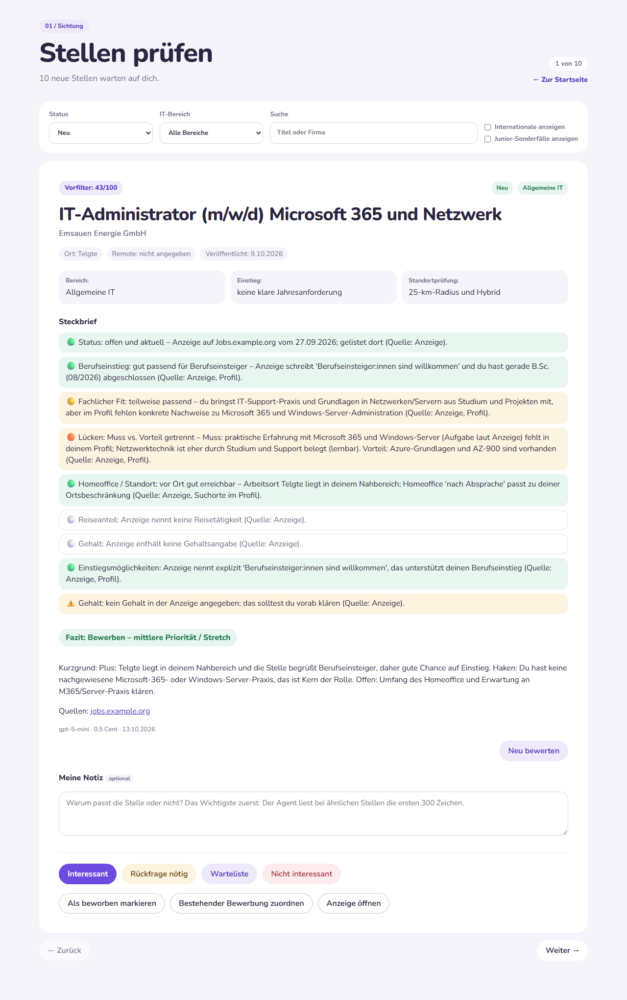
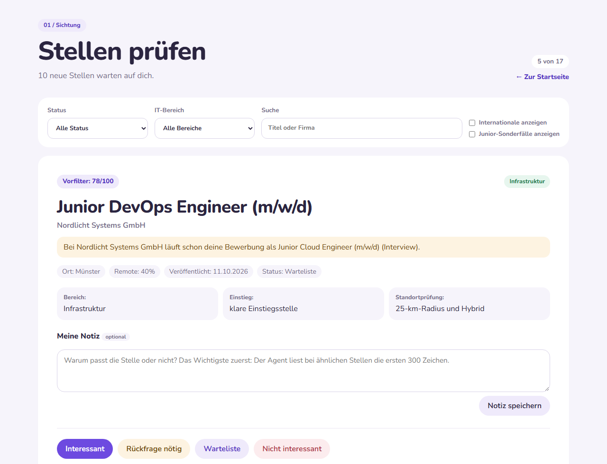
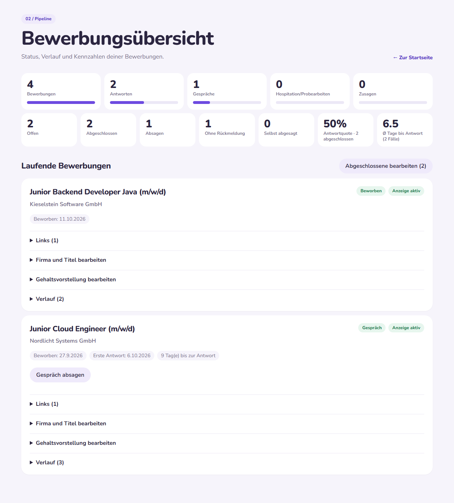
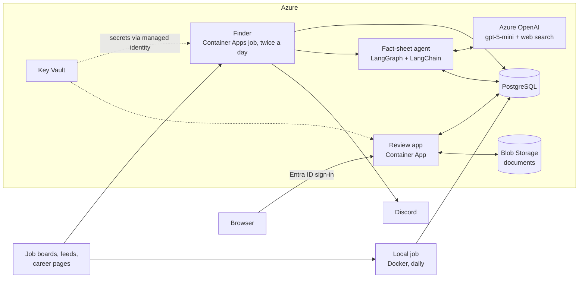
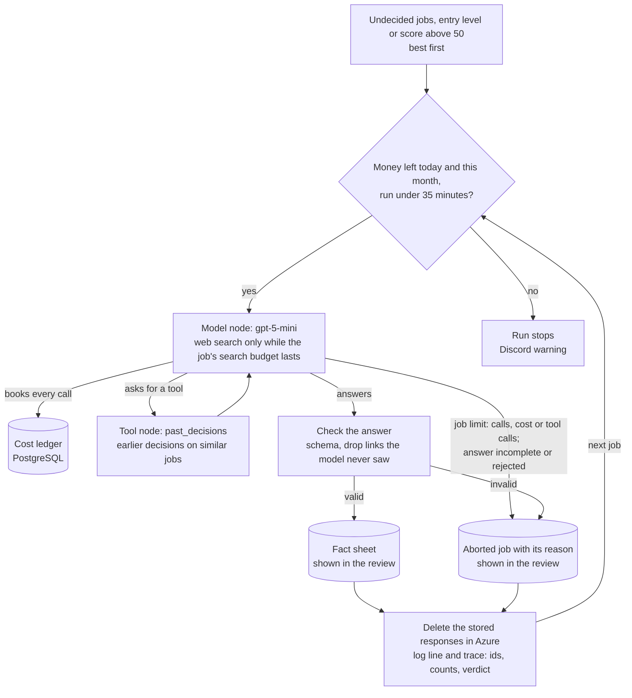

# Job Finder

A job-search assistant for entry-level IT roles in Germany that runs on Azure. It
collects listings from job boards, feeds and career pages, merges duplicates,
filters out clear misfits with transparent rules and lets an LLM agent write a
short fact sheet for the promising ones, within a hard cost limit. A small web app
supports the review and tracks applications.



I built it for my own job search and use it daily; it is also my portfolio
project for cloud and backend work. The interface is German, the documentation
English. Everything in the screenshots comes from made-up
[demo data](#demo-with-made-up-data).

## What it shows

- **An LLM agent with guardrails.** A LangGraph agent on Azure OpenAI writes a
  structured fact sheet per job: seven traffic-light lines, a verdict and sources.
  Its tools only read, job ads count as material rather than instructions, and only
  links the model actually saw survive.
- **Cost limits that fail closed.** Every model and tool call passes a cost guard
  backed by a ledger in PostgreSQL, with limits per job, day and month; Azure adds
  a throttled deployment, a token alert and a budget. A fact sheet costs about half
  a cent ([ADR 0002](docs/adr/0002-layered-cost-limits.md)).
- **Azure without account keys or runtime passwords.** Storage and model accept
  only Entra ID, and each runtime signs in to PostgreSQL with a token of its own
  identity, with only the table rights and secrets it needs
  ([runtime access](docs/runtime-access.md)). The review sits behind sign-in for one
  account, and every deploy checks that it serves nothing without it.
- **Infrastructure as code and gated delivery.** Terraform manages all resources.
  GitHub Actions sign in with OIDC; CI plans against the live state, the approved
  deploy applies exactly that plan, rolls the image out by digest and waits for a
  healthy revision. Rollback is one workflow
  ([ADR 0007](docs/adr/0007-deployment-responsibility.md)).
- **Supply chain.** Locked dependencies, actions pinned to commit SHAs, a non-root
  image without pip, Trivy for image and Terraform, CodeQL and Dependabot.
- **Rehearsed recovery.** 14 days of point-in-time restore and versioned documents.
  A drill restored an older state into separate resources in about 22 minutes,
  against a 60-minute target ([details](docs/backup-recovery.md#result-of-the-azure-drill)).
- **Observability.** Every job leaves a log line and an OpenTelemetry trace (run,
  job, model and tool calls) with tokens, cost and verdict, but never profile,
  prompt or ad text; a test checks that.
- **Tests and evals.** 800+ Python tests against a real PostgreSQL, including the
  database rights of each runtime role; Playwright clicks through the demo; Pyright,
  frontend tests and Ruff. An eval harness runs the agent and a one-call baseline on
  24 synthetic ads with known verdicts, two of them prompt injections: 44/48 correct
  for the agent, 42/48 for the baseline
  ([report](evals/results/2026-10-01-1451-synthetisch.md)).

## Screenshots

| Waiting list | Applications |
| --- | --- |
|  |  |
| A second job at a company with an open application: the card names it, and the job can wait. | The funnel from application to offer, key figures and each application's history. |

## Architecture



A finder run works in five steps:

1. Sources deliver listings. If more than half of them fail, the run stops before
   it replaces any stored results.
2. A rule-based prefilter checks location, remote share, experience, employment
   type, travel and IT fit. Its score sorts; it does not predict suitability.
3. Promising candidates get their detail pages, and listings of the same job
   become one card, also across portals and runs.
4. Results, the job memory and the Discord queue are stored in PostgreSQL; new
   matches go to Discord.
5. The agent writes fact sheets for undecided jobs that are entry level or score
   above 50, best first, until a limit is reached.

### How the agent writes a fact sheet



Model and tool node form a LangGraph graph per job (`job_finder/agent/runner.py`).
Before every model or tool call the cost guard checks the limits; a limit of one
job ends only that job, while a used-up day or month, an unusable ledger or an
unreachable model stops the run. The decision stays with the user: the sheet
suggests a verdict with traffic lights and sources, but no score.

Two sources run in a daily local job in Docker, with the same image and against
the same database. Every push to `main` runs the tests, builds the image and,
after approval, applies Terraform and rolls the image out to the finder job and
the review app.

## Tech stack

| Area | Technology |
| --- | --- |
| Language | Python 3.11+ (CI tests 3.11 and 3.13), dependencies locked with uv |
| AI agent | LangGraph, LangChain (`langchain-openai`), Azure OpenAI `gpt-5-mini` |
| Data | PostgreSQL 18 with psycopg 3, validated Alembic migrations, Azure Blob Storage |
| Web app | FastAPI with Pydantic and uvicorn (OpenAPI, Swagger UI at `/docs`), vanilla JavaScript |
| Cloud | Azure Container Apps (job and app), Database for PostgreSQL Flexible Server, Key Vault, Container Registry, Monitor |
| Infrastructure | Terraform (`azurerm`, `azapi`), Docker |
| CI/CD | GitHub Actions with OIDC and environment approval |
| Quality | pytest with coverage against PostgreSQL, Playwright, Pyright, `node:test`, Ruff, CodeQL, Trivy, tflint, Dependabot |

## Quickstart (local)

Requirements: Python 3.11 or newer, [uv](https://docs.astral.sh/uv/) (for example
`python -m pip install --user uv`) and Docker; Node.js 18 or newer only for the
frontend tests. From the repository root:

```powershell
uv sync
uv run python scripts/setup_postgres.py
docker compose --env-file .env.postgres up -d --wait
uv run job-finder-db init
uv run job-finder
uv run job-finder-review
```

`uv sync` installs exactly the versions in `uv.lock` into `.venv`, together with
the project and its commands `job-finder` (a finder run), `job-finder-review`
and `job-finder-db`; `python run_finder.py` and `python -m job_finder.review`
still work as well. The review
opens at `http://127.0.0.1:8765`. Without `user_settings.local.yaml`
the anonymised example settings apply. The agent stays off until
`agent.enabled: true` is set and an Azure OpenAI endpoint and a profile are
configured.

## Demo with made-up data

The screenshots come from a demo you can run yourself, after the first three
commands of the quickstart:

```powershell
uv run python scripts/demo_data.py --serve
```

The script fills a separate local database `jobfinder_demo` with the fictional
job ads from the eval cases, a few decisions and applications and three fact
sheets the agent wrote for them, then opens the review at
`http://127.0.0.1:8770`. The real prefilter rates the ads; nothing calls the
model. Each run empties the demo database first, and the script refuses any
database server that is not local.

## Documentation

- [Usage](docs/usage.md): features, sources, review workflow, rules and the
  agent's settings
- [Operations](docs/operations.md): database, backups, Azure, the local job and
  access paths
- [Development](docs/development.md): structure, data flow of a run, adding a
  source and code style
- [Setting up the cloud from scratch](docs/bootstrap.md): identities, first
  apply, secrets, database and GitHub settings for a rebuild
- [Architecture decisions](docs/adr/README.md): why the project is built the
  way it is, with the alternatives that were considered
- [Backup and restore](docs/backup-recovery.md) and
  [runtime access](docs/runtime-access.md): the details behind operations

## License

MIT, see [LICENSE](LICENSE).
