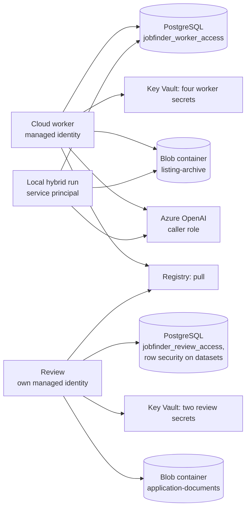

# Runtime access

Worker, review and the local hybrid run each have their own Azure identity,
only the secrets they need and their own PostgreSQL login. The logins sign in
with short-lived Entra tokens; no runtime holds a database password. Separate
identities (F09) have been in production since 04.10.2026, the token sign-in
(F10) since 06.10.2026.



| Area | Cloud worker | Review | Local hybrid worker |
| --- | --- | --- | --- |
| Identity | worker managed identity | own review managed identity | own service principal |
| ACR | AcrPull | AcrPull | pull through the host's sign-in |
| Key Vault | `DiscordWebhookUrl`, `StartupJobsApiKey`, `JobfinderUserSettings`, `JobfinderProfile` | `ReviewAadClientSecret`, `JobfinderUserSettings` | no vault role; local ignored configuration |
| Model | caller role | no model role | optional caller role |
| Blob Storage | Contributor only on `listing-archive` | Contributor only on the document container | Contributor only on `listing-archive` |
| Terraform state | no access | no access | no access |
| Database login | `jobfinder_worker_entra` | `jobfinder_review_entra` | `jobfinder_hybrid_entra` |
| Database group | `jobfinder_worker_access` | `jobfinder_review_access` | `jobfinder_worker_access` |

Secret roles sit on single secret resources of the vault
([Microsoft: Key Vault RBAC](https://learn.microsoft.com/en-us/azure/key-vault/general/rbac-guide)).
Both workers set `JOBFINDER_SKIP_RUN_BACKUP=1`: they write document metadata
but never touch document bytes. Manual document backups and restores run as
administrator or owner.

## PostgreSQL contract

| Tables | Worker/hybrid | Review |
| --- | --- | --- |
| `job_state`, `workflow_history`, `application_documents`, `job_listings`, `job_links` | SELECT/INSERT/UPDATE/DELETE | SELECT/INSERT/UPDATE/DELETE |
| `datasets`, `jobs`, `recommendations`, `manual_sources` | SELECT/INSERT/UPDATE/DELETE | SELECT/INSERT/UPDATE/DELETE; row boundary see below |
| `agent_usage`, `agent_fact_sheets`, `runs` | SELECT/INSERT/UPDATE/DELETE | only SELECT |
| `notifications`, `source_cache` | SELECT/INSERT/UPDATE/DELETE | no rights |
| Version markers, import journal and new tables | no rights | no rights |
| DDL, TRUNCATE, role management, object ownership | no rights | no rights |

The rights belong to the two NOLOGIN groups; the logins only inherit them. New
tables get no implicit runtime rights. Revision `0002_runtime_boundaries`
enables row level security on `datasets`: members of the review group may see
and change only `internal/jobs.json`, `output/recommendations.json` and
`internal/manual_jobs_cache.json`, so they cannot delete a worker data set and
with it its `notifications` or `source_cache` through a foreign key cascade.
The membership counts also with `SET ROLE` to the group. Table owners and
BYPASSRLS principals must therefore never be runtime roles.
[PostgreSQL: row security](https://www.postgresql.org/docs/18/ddl-rowsecurity.html)

## Token sign-in

`JOBFINDER_DATABASE_AUTH` decides the runtime sign-in:

| Value | Sign-in | Used by |
| --- | --- | --- |
| `password` (default) | DSN with password | local development and tests, the own `jobfinder_app` access |
| `managed_identity` | PostgreSQL token | worker and review, with `JOBFINDER_MANAGED_IDENTITY_CLIENT_ID` |
| `service_principal` | PostgreSQL token | hybrid run, with `AZURE_TENANT_ID`, `AZURE_CLIENT_ID`, `AZURE_CLIENT_SECRET` |

With a token, `JOBFINDER_DATABASE_URL` is a DSN without a password, with
explicit host, database, role and `sslmode=verify-full`. Terraform sets it for
worker and review (output `entra_database_urls`). The token is passed only in
memory as the driver password, never in a DSN, file, state, command line or
log. Every new connection asks for a token; the Azure SDK renews it. The
credential is chosen explicitly, without falling back to the developer's Azure
CLI sign-in; a missing identity, a password DSN, missing TLS verification or a
token error abort without a password fallback.

The hybrid runner reads its DSN from `JOBFINDER_HYBRID_ENTRA_DATABASE_URL` in
the ignored `.env.runtime-azure`:

```text
JOBFINDER_HYBRID_ENTRA_DATABASE_URL=postgresql://jobfinder_hybrid_entra@example.postgres.database.azure.com:5432/jobfinder?sslmode=verify-full&sslrootcert=/etc/ssl/certs/ca-certificates.crt
```

It checks role, host, port and database against `.env.postgres-azure` (whose
host also names the firewall rule's server), refuses passwords and uses the
Linux CA bundle in the container. The service principal comes from
`.env.docker-local`.

Administrative maintenance stays separate: `transaction(admin=True)` and Alembic
use only `JOBFINDER_ADMIN_DATABASE_URL` with the password administrator
`jobfinder_admin`, which also serves as the emergency access. Server password
authentication therefore stays on.

## Setting up groups and logins

`scripts/create_entra_roles.py` sets up the groups, their table rights and the
three logins. It uses two administrative logins to the same server:

- `JOBFINDER_ENTRA_ADMIN_DATABASE_URL` from `.env.entra-azure`: a password-free
  DSN of the personal Entra administrator (`postgres_entra_admin_name`) to the
  database `postgres`. Only this helper obtains its token, through an explicit
  `AzureCliCredential`.
- `JOBFINDER_ADMIN_DATABASE_URL` from `.env.postgres-azure`: the password
  administrator in the application database. It manages the groups and their
  rights.

```powershell
terraform -chdir=infrastructure output -json entra_principals > tmp/entra-principals.json
uv run python scripts/create_entra_roles.py --principals-file tmp/entra-principals.json
uv run python scripts/create_entra_roles.py --principals-file tmp/entra-principals.json --apply
```

Without `--apply` the helper only checks. `--apply` applies the fixed table
rights to the two groups, creates the missing non-admin logins through
`pgaadauth_create_principal_with_oid` with the object IDs (not client IDs) of
the identities, and grants each its group. It reads back tenant, object ID,
principal type and admin flag and checks role attributes, memberships, the
effective table rights and the review row policy. A missing row boundary,
`PUBLIC` table rights, foreign memberships, privileged roles, an object ID bound
elsewhere or a role of the same name without the right Entra mapping abort; the
helper repairs nothing automatically. Identities are created in `postgres`, the
memberships in the application database; if the second step fails, running the
helper again continues safely.

## Local checks and their limit

The auth tests simulate credential choice, token change and error cases. The
rights tests run against real local PostgreSQL roles (with passwords standing in
for Entra logins) and check the groups, review row security, table and DDL
boundaries and repetition; only Azure's principal API is simulated. Terraform
tests simulate all providers. None of this replaces a check in Azure.

## Sources

- [Microsoft: sign-in with a managed identity](https://learn.microsoft.com/en-us/azure/postgresql/security/security-connect-with-managed-identity)
- [Microsoft: managing Entra principals](https://learn.microsoft.com/en-us/azure/postgresql/security/security-manage-entra-users)
- [Microsoft: authentication modes, restart and token lifetime](https://learn.microsoft.com/en-us/azure/postgresql/security/security-entra-concepts)
